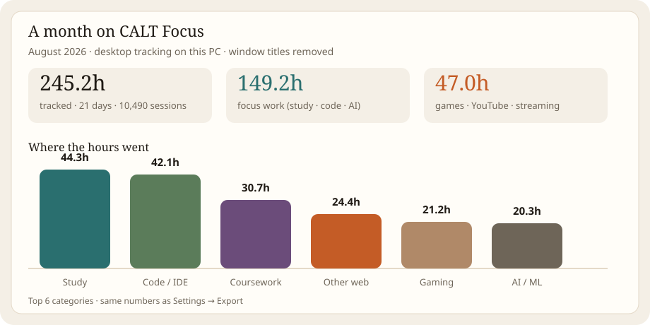
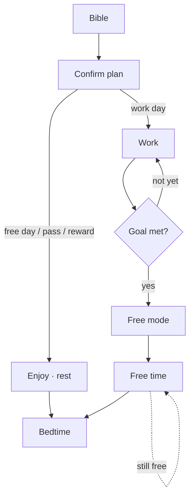
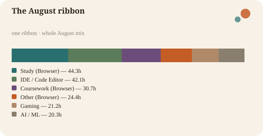
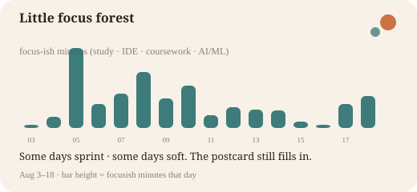
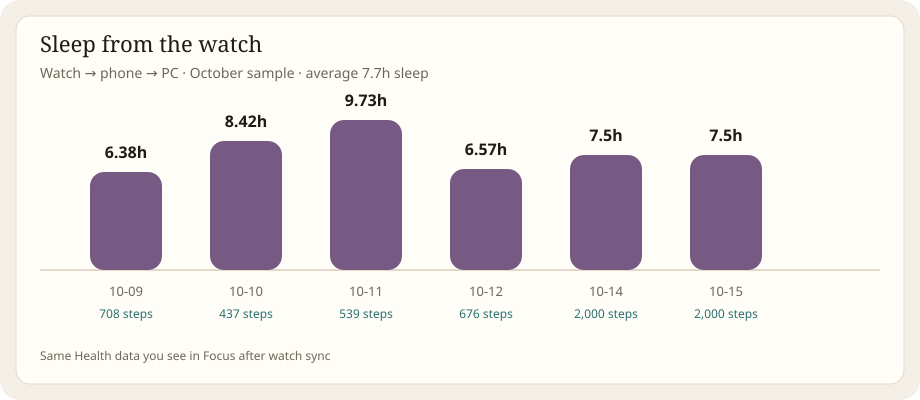

<p align="center">
  
</p>

**Your day, on purpose.**

A Windows app that helps you start with Scripture, plan the day, stay on task, and unlock free time when you’ve earned it — all on your PC, no cloud account required.

<p align="center">
  
</p>

---

## In one minute

Most tools either block websites **or** kill apps. CALT Focus does both as **two separate switches**, then wraps them in a simple daily rhythm:

1. **Bible** — morning, then afternoon (from noon), then evening (from 5pm)  
2. **Plan** — confirm today’s calendar (at least one planned minute)  
3. **Work** — start a focus session with an Allow list  
4. **Unlock** — hit your goal, claim a reward day, or spend a day pass  

Until today’s Bible slots and plan are done, Focus keeps you on those screens and site blocking stays strict. After you confirm the plan, site block and app Arm can run together — still as **separate** controls.

**Site block ON does not Arm apps.** A wrong blocked page is a refresh away; a wrong kill is not. That split is the product.

---

## A typical day

```text
Wake up
  → Site block on · Arm off
  → Morning Bible → Confirm today’s plan
  → Site block + Arm couple for the day
  → Afternoon Bible · Evening Bible when those hours arrive
  → Hit your focus goal or chores → free time / reward / pass
  → Bedtime · type EMERGENCY only if you need a wind-down
```

| How you unlock | What you get |
|----------------|--------------|
| **Daily focus goal** | Free browsing until end of day |
| **Check unlock** | +60 minutes once when chores + plan progress line up |
| **Reward day** | A full free day after a qualifying streak (type `REWARD`) |
| **Day pass** | A limited weekly pass (type `PASS`) |
| **Earned minutes** | Small credits from Bible / plan / goal — spend in 15‑minute chunks |

Planning stays on. Yesterday’s plan does not roll into today.



---

## Two blockers — keep them separate

| | **Site block** | **Arm** |
|--|----------------|---------|
| Stops | Websites in the browser | Desktop apps |
| Good for | YouTube, rabbit holes, distraction sites | Games, chat apps on the kill list |
| Cannot | Kill Steam | Block a URL |
| Mode-aware | Yes — schedules, free windows, incubation | Yes — free time pauses kills |

**Device lock** is an optional hard lock on Windows — separate from Allow lists and free windows.

Deep rules: [`docs/BLOCKING_RULES.md`](docs/BLOCKING_RULES.md).

---

## What you get

| Area | Highlights |
|------|------------|
| **Home** | Day glance, Confirm plan, work session Allow + Start/End, unlock check |
| **Calendar & Plan** | Day/week/month, drag blocks, routines, sleep windows, actuals overlay |
| **Bible & Journal** | Reader + morning/afternoon/evening devotion · mark done · journal autosave |
| **Settings** | Overview · Blocks (sites / apps) · Unlock · Productive · More |
| **Gate** | Edge extension for site decisions + tab time |
| **Health** | Amazfit/Zepp sync → sleep, steps, HR on the Health tab |
| **Tray** | Open Home / Plan / Bible / Settings · Reload UI · Quit only when disarmed |

Typed confirms in Settings: `UNLOCK` · `REWARD` · `PASS` · `DEVICE LOCK`.

---

## A month in the life

Real numbers from this PC — **August 2026** desktop tracking, plus **October** watch sleep after Health sync. Titles stripped; categories kept. Raw files: [`docs/examples/`](docs/examples/).

### August · time on the PC

| | |
|--|--|
| **245 hours** across **21** days | **10,490** sessions |
| **~149h** focus work | study · code · coursework · AI |
| **~47h** play / video | games · YouTube · streaming |
| Peak hours | late morning **10–11** (also strong **8–9**) |
| Rewards | 5 qualifying August days in the ledger |





### Sleep · watch → PC

Once the watch syncs, Health shows nights like this (October sample):



| Night | Sleep | Steps |
|-------|------:|------:|
| Oct 9 | 6.4h | 708 |
| Oct 10 | 8.4h | 437 |
| Oct 11 | 9.7h | 539 |
| Oct 12 | 6.6h | 676 |
| Oct 14–15 | 7.5h | 2000 |

### Export your own

**Settings → More → Export** writes JSON + CSV under `data/productivity/behavior/`.

Demo copies: [`august_2026_sample_export.json`](docs/examples/august_2026_sample_export.json) · [`august_2026_day_metrics.csv`](docs/examples/august_2026_day_metrics.csv)

---

## Install (Windows)

```bat
scripts\build\build_native_enforcer.bat
powershell -File scripts\install\install_native_enforcer.ps1
```

```bat
npm run build:focus
scripts\run\run_calt_desktop.bat
```

Load the Gate extension from `extensions/calt-gate-extension` in Edge (unpacked). Use the tray to open Focus and **Reload UI** after UI updates.

Watch setup: [`docs/WEARABLES.md`](docs/WEARABLES.md).

---

## How it fits together

```text
CALT Focus app          Window + tray (WebView UI)
        │ reads           local day / plan / status files
        │ writes          commands to the enforcer
        ▼
Enforcer service        Site rules · Arm kills · day loop · tracking
        ▲
Gate (Edge)      ────── soft decisions + tab tracking

Sync host (optional)    Watch / Health ingest on the LAN
```

Everything important lives on disk: SQLite + small JSON mirrors. No account required.

---

## Docs

| Doc | What |
|-----|------|
| [BLOCKING_RULES.md](docs/BLOCKING_RULES.md) | Exact site / Arm / unlock rules |
| [SETTINGS.md](docs/SETTINGS.md) | Every Settings control |
| [FE_FLOWS.md](docs/FE_FLOWS.md) | Screen flows |
| [WEARABLES.md](docs/WEARABLES.md) | Watch → PC |
| [examples/](docs/examples/) | Sample export + charts |
| [AGENTS.md](AGENTS.md) | Contributor notes |
