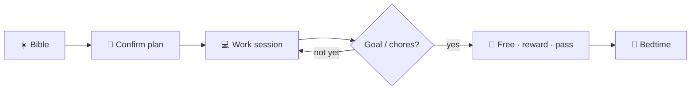

# CALT Focus

**Local-first productivity OS for your PC** — plan the day, keep SoftLand and Arm honest, read Scripture in morning / afternoon / evening slots, track work, and unlock free time by earning it.

CALT Focus is a **standalone Windows product**. It does not need Study (GRE/notes) or a Python SoftLand server. Everything that blocks sites, kills apps, tracks time, and gates the morning ritual runs as native C++ on this machine.

---

## What it is for

Most blockers are either “annoying websites” or “kill Steam.” Focus keeps those as **two separate weapons**, then wraps them in a **day loop** so the morning is intentional:

1. **Bible** — morning always; afternoon from 12:00; evening from 17:00  
2. **Plan** — confirm at least one planned minute  
3. **Work** — Home session Allow list + Start / End  
4. **Earn unlocks** — daily focus minutes, reward days, day passes, earned ledger  

Until due Bible slots and today’s plan are clear, Focus stays on the ritual surfaces and SoftLand keeps non-allow sites blocked. After Confirm, SoftLand + Arm couple for the day — still as **separate switches**.

**SoftLand ON ≠ Arm.** Turning site blocking on never arms process kills. That split is intentional: a wrong site verdict self-corrects on the next navigation; a wrong kill is destructive.

---

## The day at a glance

```text
New day
  → SoftLand on, Arm off
  → Morning Bible → Confirm plan (≥1 planned minute)
  → SoftLand + Arm couple for the day
  → Afternoon Bible due from 12:00 · Evening from 17:00
  → Hit focus goal / chores → free windows, reward, or day pass
  → Bedtime overlay · optional EMERGENCY wind-down
```

| Unlock path | What it does |
|-------------|--------------|
| **Daily focus goal** | Productive minutes → free until end of day (porn heuristic still on) |
| **Check unlock** | Tasks done + ≥50% of planned non-free → +60 minutes once |
| **Reward day** | Qualifying streak → claim a free day (type `REWARD`) |
| **Day pass** | Limited weekly passes (type `PASS`) |
| **Earned minutes** | Bible / plan / goal chores → spend in 15‑minute chunks |

Planning cannot be turned off. Plans do **not** carry forward from yesterday.



---

## A month in the life (real owner data)

Postcards from **this** machine — August 2026 desktop tracking + a later October watch dump. Window titles stripped; categories kept. Full tidy export: [`docs/examples/`](docs/examples/).

### August 2026 · desktop tracking

| | |
|--|--|
| **245h** tracked across **21** days | **10,490** sessions |
| **~149h** study / IDE / coursework / AI-ish | **~47h** games · YouTube · streaming |
| Top slice | Study 44h · Cursor/IDE 42h · Coursework 31h · Gaming 21h · AI/ML 20h |
| Rewards ledger | 5 qualifying days recorded in August (plus uses) |


Peak hours on the PC were late morning (**10–11**), with solid **8–9** blocks too — classic “open the laptop and go” energy.

### Sleep & Health (watch → PC)

August sleep wasn’t on the Amazfit path yet. Once **CALT Sync** landed, Health mirrors look like this (October sample from `life_history_14.json`):

| Night | Sleep | Steps (same day) |
|-------|------:|-----------------:|
| Oct 9 | 6.4h | 708 |
| Oct 10 | 8.4h | 437 |
| Oct 11 | 9.7h | 539 |
| Oct 12 | 6.6h | 676 |
| Oct 14–15 | 7.5h | 2000 |


### Take your own export

Settings → **More** → Export writes:

- `data/productivity/behavior/productivity_export.json`
- `data/productivity/behavior/productivity_export.csv`

Repo demo copies (August rollup + day CSV):

- [`docs/examples/august_2026_sample_export.json`](docs/examples/august_2026_sample_export.json)
- [`docs/examples/august_2026_day_metrics.csv`](docs/examples/august_2026_day_metrics.csv)

---

## Two blockers (do not merge them)

| | **Site block (SoftLand)** | **Arm** |
|--|---------------------------|---------|
| Blocks | Websites in the browser | Desktop apps (OS kill list) |
| Switch | SoftLand / “Site block” | Arm / “Armed” |
| Engine | Gate extension → `calt_msg_host` | `calt_enforcer` kill loop |
| Can block YouTube? | Yes | No |
| Can kill Steam? | Never | Yes |
| Mode-aware? | Yes (schedule → free → incubation) | Yes (free / study-free pauses kills) |

There is also **Device lock** (Windows `hosts` for porn domains) — independent of SoftLand allowlists and free windows. Settings UI groups Sites / Apps / Filters under **Blocks**; that is UX grouping, not one engine.

Full rule book: [`docs/BLOCKING_RULES.md`](docs/BLOCKING_RULES.md).

---

## Features

### Home
- Day glance: productive minutes, Bible, plan, SoftLand / Arm status  
- **Confirm plan** CTA when the morning ritual is due  
- **Work session** — Allow apps/sites, Start / End focus block  
- **Check unlock** when dual-gate chores are met  
- Jarvis / local LLM chip for status, suggestions, and in-app commands  

### Plan & Calendar
- Day / week / month calendar with create, drag, delete  
- Routines, sleep windows, goals blocks  
- Active plan can drive SoftLand mode after Confirm  
- Desktop + browser actuals overlay on the calendar  

### Bible & Journal
- Built-in reader + **morning / afternoon / evening** devotion slots  
- Mark chapter done clears the SoftLand Bible gate for that slot  
- Change reading / assign chapter for today  
- Journal with autosave (today + history)  

### Settings
| Section | What you control |
|---------|------------------|
| **Overview** | What’s on, day flow, jump cards |
| **Blocks** | SoftLand sites (Allow / Watch / Block), Arm kill list, filters |
| **Unlock** | Daily goal, reward / day pass, Arm arming |
| **Productive** | What minutes count + classification |
| **More** | Look, planning, export, LLM / Jarvis, email report, Quit, Watch ↔ PC |

Confirm phrases (typed): `UNLOCK`, `REWARD`, `PASS`, `DEVICE LOCK`.  
Every control mapped: [`docs/SETTINGS.md`](docs/SETTINGS.md).

### Gate (browser)
- Edge extension talks to `calt_msg_host` for SoftLand decide + tab tracking  
- Scored / layered blocking, NSFW image scan (WASM), appeals  
- Without a fresh Gate heartbeat, Edge can be closed while SoftLand is on (Focus WebView is not)  

### Health & wearables
- Amazfit / Zepp **CALT Sync** → phone → `calt_sync_host` on `:8765`  
- Life / Health UI from last dump (`life_days`, wearable mirrors)  
- Setup: [`docs/WEARABLES.md`](docs/WEARABLES.md) · watch package [`packages/calt-zepp`](packages/calt-zepp)  

### Math → ML
- Offline roadmap UI (`/math`) with progress in SQLite via enforcer `roadmap.*`  

### Shell & tray
- `calt_focus.exe` — WebView2 UI + system tray (not Electron / Qt)  
- Tray: Open Home / Calendar / Plan / Settings / Bible, Reload UI, Update stack  
- **Quit refused** while SoftLand is on or Arm is armed  

### Remote & extras
- Optional Telegram remote for status / light commands  
- Local LLM host / OpenJarvis for Suggest + free chat  
- Email daily report (mailto) from Settings → More  

---

## How the stack fits together

```text
calt_focus.exe          Tray + WebView2 (React UI from dist-focus/)
        │ reads           behavior/*.json mirrors  (calt-data.app)
        │ writes          enforcer_cmd named pipe
        ▼
calt_enforcer.exe       SoftLand SoT, Arm kills, day loop, plan, Bible, sessions
        ▲
calt_msg_host.exe  ◄──  Gate extension (get_mode, track_tab, SoftLand decide)

calt_sync_host.exe      Wearables ingest :8765 (optional)
```

| Idea | Detail |
|------|--------|
| **SoT** | `data/productivity/productivity.db` |
| **Fast reads** | JSON mirrors under `data/productivity/behavior/` |
| **Writes** | Focus → pipe → enforcer gateway (no Python for arm/kill/track/status) |
| **UI ship** | React SPA → `dist-focus/`; design HMR on Study sibling `:5180` |

Agent / contributor context: [`AGENTS.md`](AGENTS.md).  
Click-test flows: [`docs/FE_FLOWS.md`](docs/FE_FLOWS.md).

---

## Quick start

```bat
scripts\build\build_native_enforcer.bat
powershell -File scripts\install\install_native_enforcer.ps1
:: Admin once for the CALTEnforcer service
```

```bat
npm run build:focus
scripts\run\run_calt_desktop.bat
```

Install Gate from `extensions/calt-gate-extension` (unpacked in Edge). After UI sync, tray **Reload UI**.

| Script area | Purpose |
|-------------|---------|
| `scripts\build\` | Enforcer, Focus shell, msg-host |
| `scripts\install\` | Service + native messaging |
| `scripts\run\` | Desktop, sync host, stop helpers |

---

## Repo layout

```text
backend/           calt_enforcer · calt_focus · calt_msg_host · calt_sync_host
dist-focus/        Shipped React UI (WebView)
extensions/        Gate + SelfTracker
frontend/          Thin Focus entry + Math→ML roadmap
packages/calt-zepp Amazfit / Zepp sync app
data/productivity  DB + behavior mirrors + bible corpus
docs/              Settings, blocking rules, flows, wearables
scripts/           build · install · run
```

---

## Naming cheat sheet

| You see in UI | Code / SoT (keep forever) |
|---------------|---------------------------|
| Site block / Blocker (sites) | `softland_enabled`, `softland_*` |
| Arm / Blocker (apps) | `hard_block_armed`, kill list `exes` |
| Device porn lock | `device_block.*` → Windows hosts |

---

## Docs

| Doc | Audience |
|-----|----------|
| [BLOCKING_RULES.md](docs/BLOCKING_RULES.md) | Exact SoftLand / Arm / unlock rules |
| [SETTINGS.md](docs/SETTINGS.md) | Every Settings control → FE → enforcer |
| [FE_FLOWS.md](docs/FE_FLOWS.md) | Screen flows + live vs backend-only |
| [WEARABLES.md](docs/WEARABLES.md) | Watch → PC sync |
| [examples/](docs/examples/) | Real August export + SVG postcards |
| [AGENTS.md](AGENTS.md) | How to work in this repo |
